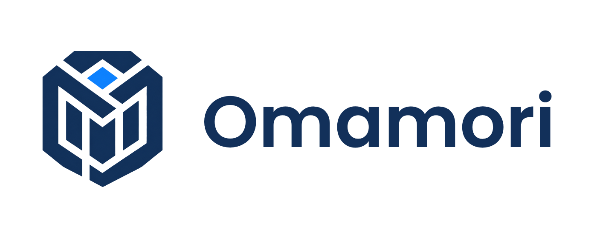

  <picture>
    <source media="(prefers-color-scheme: dark)" srcset="docs/assets/logo-dark.png">
    
  </picture>

# Omamori (お守り)

[English](README.md)

ブルーチーム(防御側)の仕事を助ける AI ヘルパーです。プロジェクトの露出チェック、
sshd ログの調査、検知ルール作りの手伝いをします。AI が使えるのは読み取り専用の
ツールだけです。AI とあなたのデータの間には「ガード」があります。

**状況: 作り始めたところです。** まだ動きません。自分の手でコードを書いています。
Go も勉強しながら進めています。

## なぜ作るのか

セキュリティチームは、検知、ログ調査、漏えいチェックなどのブルーチームの仕事に
AI を使いたいと考えています。でも、ログやコードには秘密情報や個人情報がたくさん
入っています。それをそのまま AI の会社に送るのは危険です。大きな会社では、
社内ルールに反することもあります。

Omamori はこの問題を小さくします。自分の API キーを使います。データがパソコンの
外に出る前に、ガードが見つけられる機密データを消します。

## 誰のためのツールか

会社の大きさに関係なく、セキュリティエンジニアと開発者のためのツールです。
大きな会社のセキュリティチームは、ログの確認や検知ルール作りなど、最初の調査に
使えます。セキュリティ担当がいない小さなチームも使えます。

v1 は 1 台のパソコンで動きます。ローカルのファイルと、1 種類のログ形式を読みます。
SIEM ではありません。ホスト型のサービスでもありません。

## v1 でできること

- **Task A: 露出チェック。** ローカルのプロジェクトフォルダを調べて、漏れている
  秘密情報や個人情報を探します。「このキーを変更してください」のような直し方も
  出します。
- **Task B: ログ調査。** sshd の `auth.log` を読みます。2 つのケースを探します。
  ログイン失敗がたくさん続いたあとの成功と、1 つの IP が多くのユーザー名を試す
  ケースです。AI の答えは普通のプログラムが確認します。だから AI はうそを
  つけません。
- **Task C: 検知ルール(時間があれば)。** AI がルールを提案します。Omamori が
  サンプルログで試します。
- とてもシンプルなターミナル画面: Home、Run、Results の 3 つです。
- **リプレイモード。** 記録した AI の答えを、本物の処理の流れで再生します。
  だからデモはオフラインで動きます。画面には必ず REPLAY と表示します。

## ガードのしくみ

- AI の会社にデータを送る関数は 1 つだけです。送る前にリクエスト全体をきれいに
  します。
- AI は読み取り専用のツールしか使えません。シェルもネットワークツールもありません。
- スキャンしたファイルの文字は「データ」です。「命令」としては扱いません。
- AI は自分の権限を変えられません。
- レポートには、場所、種類、プレースホルダーだけを書きます。秘密の値そのものは
  書きません。
- API キーはメモリの中にだけあります。ファイルにもログにも書きません。

## できないこと

限界をはっきり書いておきます。

- 消せるのは、見つけられる種類のデータだけです。いくつかの秘密情報の形式、
  マイナンバー、日本の電話番号です。
- v1 では、IP アドレス、名前、住所は消しません。ログ調査に IP アドレスが必要
  だからです。
- マイナンバーのチェックディジットが合っていても、「番号かもしれない」という
  意味だけです。ランダムな 12 桁の数字の約 10 個に 1 個は、偶然合います。
- AI の会社に見える情報を減らします。でも、AI の会社がデータを受け取ったあとに
  何をするかは、コントロールできません。
- 防御のためだけのツールです。攻撃コードはありません。これからも作りません。

## AI の使い方

コードはすべて自分の手で書いています。学ぶためです。AI ツールは、先生とレビュー
担当として使っています。考え方を説明してもらい、貼り付けたコードを見てもらいます。
コードは AI に書かせません。この README のような文書は、AI の助けで下書きを作り、
自分で直しています。

## ドキュメント

- [マイナンバー テスト表](docs/mynumber-test-table.md): 最初の検出器のテストケース
  です。数字はすべてダミーです。

## 計画

2027 年 2 月の就職作品の発表のために作っています。確認ポイントは 2 つです。
12 月末(Task A がガードを通して動く)と、1 月末(必須の部分がすべて完成)です。

## 技術

Go を使います。テストは `go test` で行い、ファズテストも使います。ターミナル画面は
Bubble Tea を使う予定です(まだ決まっていません)。

## ライセンス

MIT。[LICENSE](LICENSE) を見てください。
